<div align="center">


# Nishdot Web Platform

**İstanbul Nişantaşı Üniversitesi Dijital Oyun Tasarımı Kulübü'nün<br>etkinlik, başvuru ve topluluk yönetim platformu.**

Bir tanıtım sitesi değil — game jam başvurularından canlı QR çekilişlerine,
kanban görev takibinden şifrelenmiş kişisel veri yönetimine kadar
kulübün tüm operasyonunu yürüten **üretimde çalışan** bir Django uygulaması.

[](https://nishdot.com.tr)


</div>

---

## İçindekiler

- [Ekran Görüntüleri](#ekran-görüntüleri)
- [Neden Bu Proje?](#neden-bu-proje)
- [Özellikler](#özellikler)
- [Teknoloji Yığını](#teknoloji-yığını)
- [Mimari](#mimari)
- [Veri Modeli](#veri-modeli)
- [Güvenlik & Kişisel Veri Koruma](#güvenlik--kişisel-veri-koruma)
- [Öne Çıkan Teknik Çözümler](#öne-çıkan-teknik-çözümler)
- [Kurulum](#kurulum)
- [Deployment](#deployment)
- [Testler](#testler)
- [Yol Haritası](#yol-haritası)

---

## Ekran Görüntüleri

<div align="center">

### Ana Sayfa
Sonsuz kayan etkinlik fotoğrafı şeridi, sabitlenebilir etkinlik kartları ve AJAX iletişim formu.

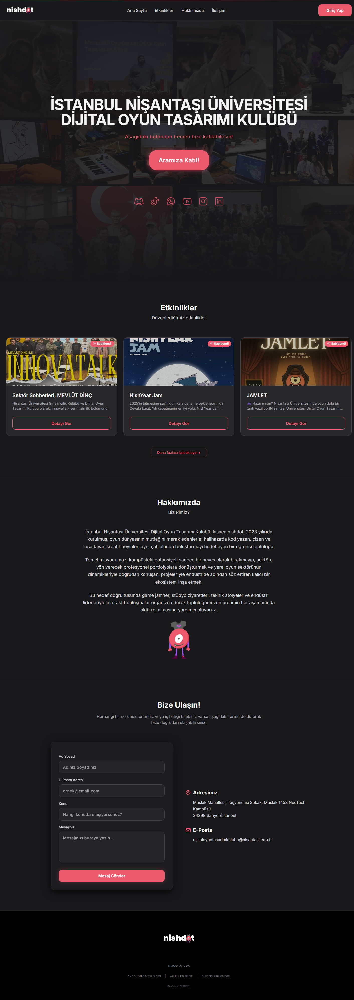

</div>

<table>
<tr>
<td width="50%" valign="top">

### Etkinlik Detayı
Zengin metin açıklama, foto galeri (lightbox), üretilen oyunlar vitrini ve başvuru akışı.

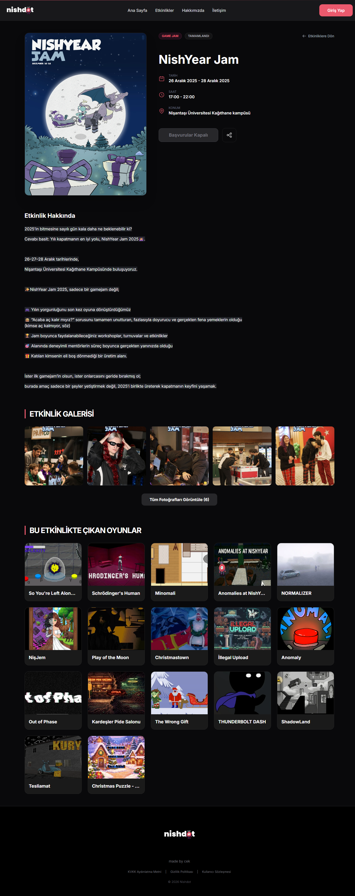

</td>
<td width="50%" valign="top">

### Başvuru Sihirbazı
Game jam'ler için 3 adımlı, istemci-taraflı doğrulamalı, KVKK onaylı başvuru formu.

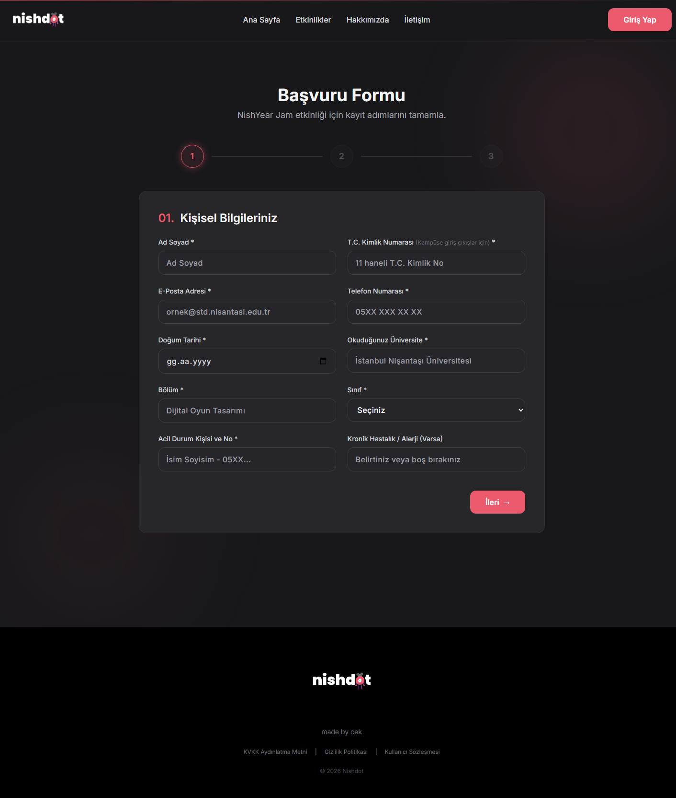

</td>
</tr>
<tr>
<td width="50%" valign="top">

### Yönetim Paneli
Başvuru takibi, güvenlik logları ve kulüp metrikleri tek ekranda.

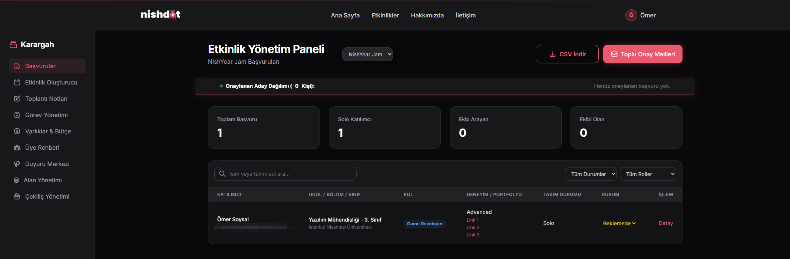

</td>
<td width="50%" valign="top">

### Etkinlik Oluşturucu
Görsel kırpma (16:9), Quill zengin metin editörü ve jam ayarları içeren tek modal.

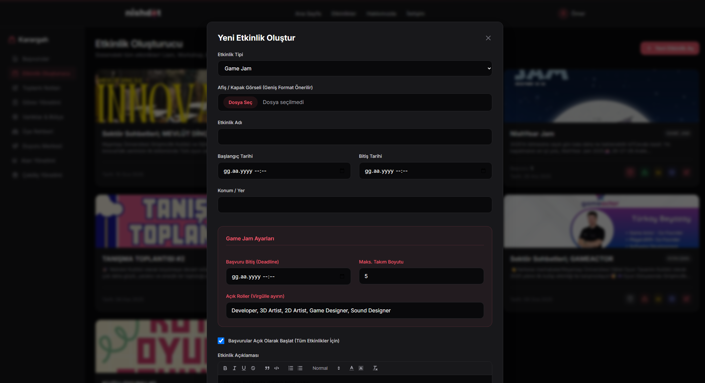

</td>
</tr>
<tr>
<td width="50%" valign="top">

### Kanban Görev Yönetimi
Sürükle-bırak yönetim kurulu görev panosu; kategori ve öncelik etiketleriyle.

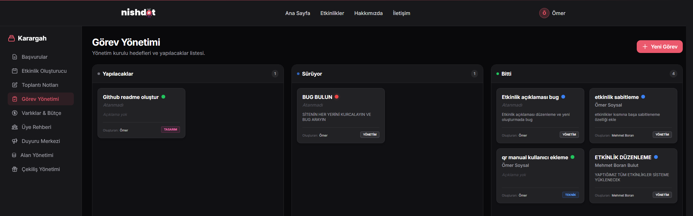

</td>
<td width="50%" valign="top">

### Canlı QR Çekilişi
Katılımcılar QR okutup anında listeye düşer, hesabı olmayan misafirler elle eklenir; sahnede tek tıkla kazanan çekilir.

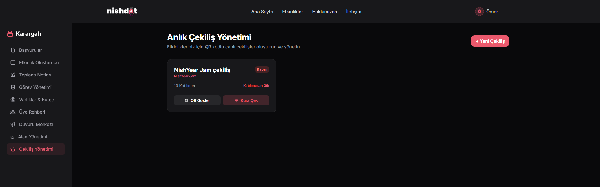

</td>
</tr>
</table>

---

## Neden Bu Proje?

Kulüp, etkinlik başvurularını Google Forms'ta, katılımcı listelerini Excel'de, görev takibini
WhatsApp'ta yürütüyordu. Bir game jam'de üç ayrı yerden veri birleştirmek, T.C. kimlik gibi
hassas verileri korumasız tablolarda tutmak ve sahnede çekiliş için kâğıt torba kullanmak
gerçek problemlerdi.

Bu platform o iş akışlarının tamamını tek bir yerde topladı:

| Önce | Sonra |
|---|---|
| Google Forms + Excel | Rol/deneyim bazlı başvuru sihirbazı, panelden filtreleme ve CSV dışa aktarım |
| Korumasız tablolarda T.C. kimlik | Fernet (AES-256) ile şifreli saklama, tekillik için ayrı hash |
| Kâğıt torbadan çekiliş | QR kodla anlık katılım, sahnede tek tıkla kazanan |
| WhatsApp'ta görev takibi | Kategori/öncelikli sürükle-bırak kanban panosu |
| Manuel duyuru mesajları | Hedef kitleye toplu e-posta + site içi duyuru merkezi |

---

## Özellikler

### Ziyaretçi & Üye Tarafı

- **Etkinlik vitrini** — Game jam, atölye, buluşma ve söyleşi tipleri; yönetimce ana sayfaya **sabitlenebilir** (pin) kartlar.
- **Etkinlik detay sayfası** — Quill ile hazırlanmış zengin metin açıklama, tarih/konum bilgi kartı, foto galeri (lightbox'lı), etkinlikte üretilen oyunların vitrini.
- **İki farklı başvuru akışı**
  - *Game jam:* 3 adımlı sihirbaz — takım durumu (solo / takımı var / takım arıyor), rol tercihi, deneyim seviyesi, acil durum iletişimi, kulübün tanımladığı özel sorular.
  - *Diğer etkinlikler:* tek adımlı hızlı form.
  - Her ikisinde de KVKK ve görsel kullanım onayı ayrı ayrı alınır.
- **QR çekilişi** — Katılımcı ekrandaki QR'ı okutur, giriş yapar ve çekilişe anında dâhil olur. Aynı kullanıcı iki kez katılamaz.
- **Yılan oyunu** — Ana sayfada liderlik tablolu yarışma; üye olmadan oynanır, skor üyelikle tabloya girer. Yarışma penceresi ve aç/kapa anahtarı admin'den yönetilir.
- **Anında üyelik** — Kayıt olan hemen giriş yapar; e-posta 3 gün geçerli bir linkle doğrulanır. Doğrulama hiçbir işlemi kilitlemez, her sayfadaki bir bantla hatırlatılır. Şifre sıfırlama Django'nun yerleşik token sistemiyle.
- **İletişim formu** — Asenkron e-posta gönderimi, gönderene otomatik bilgilendirme yanıtı, rate limit korumalı.
- **Dinamik yasal sayfalar** — KVKK, gizlilik politikası ve kullanıcı sözleşmesi panelden düzenlenebilir.

### Yönetim Paneli (`/management/`)

Kulüp yönetim kurulu için Django admin'den ayrı, göreve özel tasarlanmış bir panel:

- **Etkinlik Oluşturucu** — Tek modalda etkinlik oluşturma/düzenleme; Cropper.js ile 16:9 kapak görseli kırpma, Quill zengin metin editörü, jam'e özel ayarlar (deadline, takım boyutu, açık roller).
- **Başvuru Yönetimi** — Durum güncelleme, filtreleme, **CSV dışa aktarım**, toplu e-posta gönderimi.
- **Takım Eşleştirme** — Solo başvuranları yönetim kurulunun önerdiği takımlara gruplama (`SuggestedTeam`).
- **Çekiliş Yönetimi** — QR üretimi, canlı katılımcı listesi, sahne için tam ekran çekim görünümü, **hesabı olmayan misafirleri elle ekleme**.
- **Kanban Görev Panosu** — Sürükle-bırak; kategori (Yönetim/Etkinlik/Tasarım/Teknik/Sosyal), öncelik ve deadline.
- **Toplantı Notları** — Katılımcı takipli iç toplantı kayıtları.
- **Üye Rehberi** — Üye profillerini görüntüleme ve düzenleme.
- **Varlık & Bütçe Takibi** — Ekipman zimmeti ve harcama kaydı.
- **Duyuru Merkezi** — Site içi / e-posta duyuruları, hedef kitle seçimiyle.
- **Depolama Yöneticisi** — Sunucudaki dosyaları fiziksel silme; öksüz veritabanı kayıtlarını otomatik temizleyen **kendi kendini onaran** mantık.
- **Güvenlik Logları** — Rate limit ihlallerini (spam/brute force) IP ve tarayıcı bilgisiyle kaydeder, panelden incelenir.

---

## Teknoloji Yığını

| Katman | Teknoloji | Not |
|---|---|---|
| **Backend** | Django 6.0, Python 3.12 | Bölünmüş ayar yapısı (`base` / `development` / `production`) |
| **Veritabanı** | PostgreSQL (prod), SQLite (dev) | `django-environ` ile `DATABASE_URL` üzerinden |
| **Önbellek & Oturum** | Redis + `django-redis` | Yalnızca production |
| **Frontend** | Tailwind CSS 3.4, Vanilla JS | Framework yok; `fetch` ile JSON uçlarına konuşan sade JS |
| **Zengin Metin** | Quill 1.3.6 | Kendi sunucumuzda barındırılıyor (`static/vendor/`) |
| **Görsel İşleme** | Pillow, Cropper.js | Yüklemede otomatik WebP sıkıştırma |
| **Güvenlik** | `cryptography` (Fernet), `nh3`, `django-ratelimit` | Şifreleme, HTML sanitizasyonu, hız sınırlama |
| **Sunucu** | Gunicorn + Nginx, Ubuntu VDS | Let's Encrypt TLS |

**Neden framework'süz frontend?** Kulüp devir teslimlerinde projeyi devralacak öğrencilerin
React/build zinciri bilmesi gerekmesin diye. Django template + Tailwind + `fetch` üçlüsü,
yeni bir üyenin ilk gün katkı yapabileceği kadar sade; buna karşın sürükle-bırak kanban ve
canlı çekiliş gibi etkileşimli ekranları taşıyacak kadar yeterli.

---

## Mimari

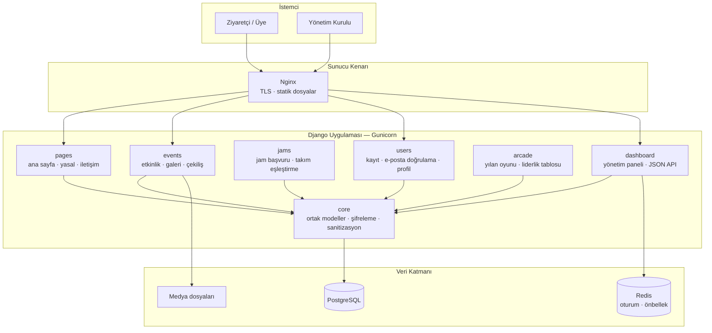

### Dizin Yapısı

```
nishdot-web/
├── nishdot/settings/     # base · development · production
├── core/                 # TimeStampedModel, crypto.py, sanitize filtresi
├── users/                # CustomUser (e-posta ile giriş), doğrulama linki
├── events/               # Event, Raffle, EventImage, EventGame, başvurular
├── jams/                 # GameJam, JamApplication, SuggestedTeam
├── pages/                # Ana sayfa, yasal belgeler, iletişim API, sitemap
├── dashboard/            # Yönetim paneli görünümleri + JSON uçları
├── arcade/               # Yılan oyunu: yarışma, skor API'si, liderlik tablosu
├── templates/            # 39 şablon (components/ altında navbar, footer)
└── static/
    ├── css/input.css     # Tailwind kaynağı → output.css
    └── vendor/           # Quill, Cropper (self-hosted)
```

---

## Veri Modeli

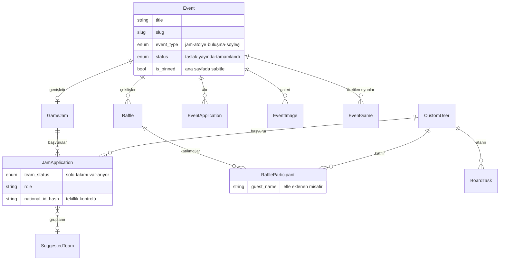

`Event` tüm etkinlik tiplerinin ortak gövdesidir; game jam'ler `GameJam` ile bire-bir
genişletilir. Böylece bir atölye ile bir jam aynı listeleme, galeri ve çekiliş altyapısını
paylaşırken, jam'e özgü alanlar (deadline, takım boyutu, roller) ayrı tabloda kalır.

---

## Güvenlik & Kişisel Veri Koruma

Kulüp, kampüs girişi için katılımcıların **T.C. kimlik numarasını** toplamak zorunda.
Bu, projenin en hassas sorumluluğu ve mimarinin bu bölümü buna göre kuruldu:

- **Şifreli saklama** — Kimlik numaraları `cryptography.fernet` (AES-256) ile şifrelenir.
  Şifreleme anahtarı (`FERNET_KEY`) Django `SECRET_KEY`'inden **bağımsızdır**; böylece
  `SECRET_KEY` rotasyonu mevcut şifreli veriyi kullanılamaz hâle getirmez.
- **Ayrı hash** — Aynı kişinin iki kez başvurmasını engellemek için şifreli veriyi çözmek
  gerekmez; bunun için ayrıca `national_id_hash` tutulur.
- **Sunucu tarafı HTML sanitizasyonu** — Quill'den gelen zengin metin `nh3` ile temizlenir.
  Şablonlarda `|safe` yerine özel `|sanitize` filtresi kullanılır → yetkili hesaplar
  üzerinden depolanmış XSS engellenir.
- **Hız sınırlama** — Giriş, kayıt, iletişim ve başvuru uçları `django-ratelimit` ile korunur.
  İhlaller `SecurityLog` modeline IP ve tarayıcı bilgisiyle yazılır, panelden incelenir.
  Nginx arkasında gerçek istemci IP'si `X-Real-IP` üzerinden okunur.
- **Admin sertleştirme** — Django admin varsayılan `/admin/` yerine `/yonetim/` altındadır;
  bu tek değişiklik otomatik bot taramalarının büyük kısmını etkisiz kılar.
- **Taslak içerik koruması** — Yayınlanmamış etkinlikler anonim ziyaretçiye 404 döner,
  yalnızca yetkili personel görebilir (test kapsamında).
- **Üretim başlıkları** — HSTS (1 yıl, preload), `SECURE_SSL_REDIRECT`, güvenli çerezler,
  `X-Content-Type-Options: nosniff`. `DEBUG` production ayarında sabit `False`.
- **Sır yönetimi** — Tüm gizli değerler `.env` üzerinden okunur; depo geçmişinde
  hiçbir noktada gömülü anahtar/parola bulunmaz.

---

## Öne Çıkan Teknik Çözümler

**Kendi kendini onaran medya deposu**
Sunucudan fiziksel olarak silinen bir görselin veritabanında öksüz kayıt bırakmasını
önlemek için galeri API'si her erişimde dosyanın diskte var olup olmadığını doğrular ve
kaybolan dosyaların kayıtlarını otomatik temizler. Şablonlarda ayrıca `onerror` yedeği
bulunur — kullanıcı hiçbir zaman kırık görsel görmez.

**Yüklemede otomatik görsel optimizasyonu**
`Event.save()` içinde Pillow ile: EXIF döndürme düzeltmesi, 1920px'e oransal küçültme ve
WebP'ye (kalite 85) dönüştürme. Yönetim kurulu telefonundan 6 MB'lık fotoğraf yükleyebilir;
siteye giden sürüm optimize edilmiş olur.

**Tek etkinlik gövdesi, iki başvuru akışı**
`event_type` alanına göre şablon ve doğrulama akışı değişir: game jam'ler 3 adımlı
sihirbaza, diğer etkinlikler tek adımlı forma yönlenir — ama listeleme, galeri, çekiliş ve
SEO altyapısı ortaktır.

**CDN bağımlılığının kaldırılması**
Quill ve Cropper.js başlangıçta CDN'den yükleniyordu. CDN erişimi kesildiğinde
`new Quill()` hata fırlatıp **tüm script bloğunu** düşürüyor, açıklama editörü ve kaydet
butonu birlikte çalışmaz hâle geliyordu. Her iki kütüphane `static/vendor/` altına alındı;
tek hata noktası tamamen ortadan kalktı.

**SEO altyapısı**
`django.contrib.sitemaps` ile dinamik `sitemap.xml` (yalnızca yayındaki etkinlikler),
`robots.txt`, sayfa bazlı benzersiz `<title>`/meta açıklama, OpenGraph ve Twitter Card
etiketleri, slug tabanlı okunabilir URL'ler.

---

## Kurulum

**Gereksinimler:** Python 3.12+, Node.js 18+ (Tailwind derlemesi için)

```bash
git clone https://github.com/Omercekadam/nishdot-web.git
cd nishdot-web
```

```bash
python -m venv venv
source venv/bin/activate        # Windows: venv\Scripts\activate
pip install -r requirements/base.txt
```

```bash
npm install
npm run build:css
```

`.env` dosyasını oluşturun (`.env.example` dosyasını referans alın):

```env
DJANGO_SECRET_KEY=gelistirme-icin-rastgele-bir-deger
FERNET_KEY=                       # aşağıdaki komutla üretin
DJANGO_SETTINGS_MODULE=nishdot.settings.development
DJANGO_ALLOWED_HOSTS=localhost,127.0.0.1
DATABASE_URL=sqlite:///db.sqlite3
```

Şifreleme anahtarını üretin:

```bash
python -c "from cryptography.fernet import Fernet; print(Fernet.generate_key().decode())"
```

Veritabanını hazırlayıp sunucuyu başlatın:

```bash
python manage.py migrate
python manage.py createsuperuser
python manage.py runserver
```

Site `http://127.0.0.1:8000`, yönetim paneli `/management/` adresinde çalışır.
Tailwind sınıflarını düzenlerken ayrı bir terminalde `npm run watch:css` çalıştırın.

---

## Deployment

Üretim ortamı Ubuntu VDS üzerinde **Nginx + Gunicorn + PostgreSQL + Redis** ile çalışır.
Adım adım sunucu kurulumu (systemd servisi, Let's Encrypt TLS, Nginx yapılandırması)
için: [`deployment_instructions.md`](deployment_instructions.md)

Güncelleme akışı:

```bash
git pull origin main
source venv/bin/activate
pip install -r requirements/production.txt
python manage.py migrate
python manage.py collectstatic --noinput
sudo systemctl restart gunicorn
```

Statik dosyalar `ManifestStaticFilesStorage` ile içerik hash'li adlandırılır — uzun süreli
tarayıcı önbelleği kullanılırken bayat dosya servis edilmez.

---

## Testler

```bash
python manage.py test
```

Kritik davranışları koruyan **27 otomatik test** mevcut:

| Alan | Kapsam |
|---|---|
| Erişim kontrolü | Taslak etkinlikler anonim kullanıcıya 404; personel görebilir |
| Çekiliş bütünlüğü | GET isteği yan etkisiz (katılım oluşturmaz), yalnızca POST katar |
| Kişisel veri | T.C. kimlik veritabanında şifreli; düz metin bulunmuyor; geçersiz numara reddediliyor |
| Sabitleme | Sabitlenmiş etkinlik daha yeni tarihli etkinliğin önünde listeleniyor |
| Yetkilendirme | Personel olmayan kullanıcı yönetim uçlarını çağıramıyor |
| Misafir katılımcı | Elle eklenen misafirler tekillik kısıtına takılmadan ekleniyor |

---

## Yol Haritası

- [ ] Mobil navigasyon menüsü (hamburger)
- [ ] `schema.org/Event` JSON-LD ile zengin arama sonuçları
- [ ] Bağımsız etkinlik listeleme sayfası ve oyun vitrini
- [ ] Hero görsellerinde lazy-loading ile LCP iyileştirmesi
- [ ] Duyuruların Discord webhook ile otomatik paylaşımı

---

## Lisans

Bu projenin telif hakkı **Ömer Soysal**'a aittir, tüm hakları saklıdır.
İstanbul Nişantaşı Üniversitesi Dijital Oyun Tasarımı Kulübü'ne (Nishdot)
yazılımı kendi faaliyetlerinde kullanma hakkı süresiz ve bedelsiz olarak
verilmiştir.

Depo yalnızca **inceleme ve referans** amacıyla herkese açıktır; kodun
kopyalanması, dağıtılması veya başka projelerde kullanılması yazılı izne
tabidir. Ayrıntılar: [`LICENSE`](LICENSE)

---

## Proje Hakkında

Nishdot Web Platform, kulübün gerçek operasyonel ihtiyaçlarından doğdu ve
[nishdot.com.tr](https://nishdot.com.tr) adresinde canlı olarak kullanılıyor.
Teknik mimari detayları için: [`docs/ARCHITECTURE.md`](docs/ARCHITECTURE.md)

**İletişim:** [dijitaloyuntasarimkulubu@nisantasi.edu.tr](mailto:dijitaloyuntasarimkulubu@nisantasi.edu.tr)
· [Instagram](https://www.instagram.com/nishdott/)
· [LinkedIn](https://www.linkedin.com/company/ni%C5%9Fanta%C5%9F%C4%B1-%C3%BCniversitesi-oyun-tasarlama-ve-geli%C5%9Ftirme-kul%C3%BCb%C3%BC)

<div align="center">
<br>
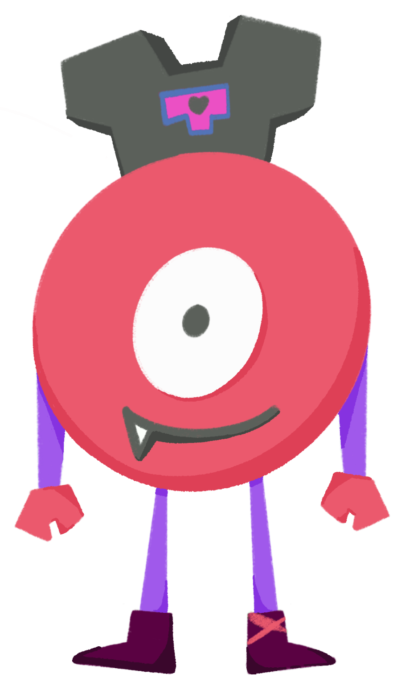
<br><sub><i>Tonish</i> — kulüp maskotu</sub>
</div>
