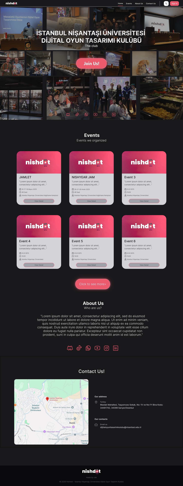

# Nishdot Web Platform - Beta+ Sürümü 

 *(Dijital Oyun Tasarımı Kulübü - Nishdot)*

İstanbul Nişantaşı Üniversitesi Dijital Oyun Tasarımı Kulübü (Nishdot) için geliştirilen resmi web platformu. Bu proje, kulüp üyelerini bir araya getirmeyi, etkinlikleri duyurmayı ve özellikle Game Jam süreçlerini modern bir arayüzle otomatize etmeyi amaçlayan dinamik, siberpunk esintili bir yönetim sistemidir.

##  Son Gelişmeler & Özellikler (Beta+)

Platform, kullanıcı deneyimini merkeze alan sistemlerle donatıldı ve etkinlik yönetimi yapısı kusursuz bir mimariye oturtuldu:

- **Gelişmiş Etkinlik Yönetimi (Karargah - Dashboard):** 
  - Sadece Game Jam'leri değil; Workshop, Buluşma, Seminer ve diğer tüm etkinlikleri tek bir merkezden oluşturma ve yönetme imkanı.
  - **Zengin Metin Editörü (Rich Text Editor):** Etkinlik açıklamalarını HTML bilmeden kalın, italik, liste ve başlık gibi formatlarla şık bir şekilde yazmayı sağlayan Quill.js entegrasyonu.
  - **Dinamik Başvuru Kontrolü:** Başvuruları tek tuşla tüm etkinlik türleri için açıp kapatabilme (`is_applications_open` evrensel mimarisi).
  - **Akıllı Görsel Kırpma:** Etkinlik afişlerini tam 16:9 oranında yüklerken tarayıcı üzerinde canlı kırpma (Cropper.js) özelliği.

- **Kullanıcı Paneli & Profil Yönetimi:** 
  - Üyelerin profillerini düzenleyebilecekleri, detaylı bilgilerini (TC, Telefon, Portfolyo vb.) güvenle yönetebilecekleri "Ajan" (Agent) profili stili panel.
  - Yapılan tüm Game Jam ve etkinlik başvurularını listeleyip, takım ve katılım detaylarını (Salt-Okunur modda) inceleyebilecekleri özel arayüz.
  
- **Duyuru Merkezi & Broadcast Sistemi (HQ):**
  - Yönetim kurulunun etkinlikleri ve kulüp haberlerini duyurabileceği gelişmiş yayın merkezi.
  - **Akıllı Hedef Kitle (Target Audience):** Duyuruları "Tüm Üyelere", "Sadece Yönetim Kuruluna" veya "Özel Seçilmiş Kullanıcılara" gönderebilme.
  - **İnteraktif Bildirimler:** Üyelerin okudukları duyuruları panolarından şık bir animasyonla gizleyebildiği (Dismiss) kişiselleştirilmiş deneyim.

- **Matchmaker (Takım Eşleştirici) Altyapısı:**
  - Game Jam süreçlerinde "Ekip Arıyorum" veya "Ekibim Var" algoritmalarıyla öğrencileri tek potada eriten sistem.
  - Yönetim tarafından atanan takımların anında öğrenci paneline bildirim olarak düşmesi.

- **Siberpunk & Kusursuz Tema (Design Polish):** 
  - Tailwind CSS ile tamamen milimetrik olarak hizalanmış pürüzsüz arayüz hatları. 
  - Siyah/Çinko mat arka planlar ve "Nish Pembesi" (`#eb596d`) ile neon kontrastı. 
  - Modallar, özel kaydırma çubukları (custom scrollbar), empty state (boş durum) uyarıları ve mikro-animasyonlarla zenginleştirilmiş akıcı deneyim.

##  Sıradaki Hedefler (Optimizasyon & Deployment)

- **Production Ortamına Geçiş:** Sistemin canlı sunuculara, PostgreSQL ve Nginx/Gunicorn konfigürasyonlarıyla aktarılması.
- **Güvenlik ve Performans:** Veritabanı N+1 sorgularının engellenmesi, önbellekleme (Caching) stratejilerinin uygulanması.
- **Discord Webhook Entegrasyonu:** HQ'dan atılan duyuruların doğrudan Discord sunucusuna resmi bir duyuru olarak iletilmesi.

##  Teknoloji Yığını

- **Backend:** Python 3.12+, Django 5.x
- **Frontend:** Django Templates + Tailwind CSS v4 (Vanilla JS ile SPA hissiyatı)
- **Veritabanı:** SQLite (Geliştirme) / PostgreSQL (Production)
- **Özel Eklentiler:** Quill.js (Rich Text), Cropper.js (Görsel İşleme)
- **Ortam Yönetimi:** `django-environ` ile güvenli ortam değişkenleri


##  Kurulum (Geliştiriciler İçin)

### 1. Repoyu Klonlayın
```bash
git clone https://github.com/Omercekadam/nishdot-web.git
cd nishdot-web
```

### 2. Sanal Ortam (Virtual Environment)
```bash
python -m venv venv
# Windows: venv\Scripts\activate
# macOS/Linux: source venv/bin/activate
```

### 3. Bağımlılıkları Yükleyin
```bash
pip install -r requirements/development.txt
```

### 4. Frontend (Tailwind CSS) Derleme
Projeyi geliştirirken Tailwind'in anlık derlenmesi için yeni bir terminalde şu komutu çalıştırın:
```bash
npx @tailwindcss/cli -i ./static/css/input.css -o ./static/css/output.css --watch
```

### 5. Veritabanı ve Çalıştırma
```bash
python manage.py migrate
python manage.py createsuperuser
python manage.py runserver
```
